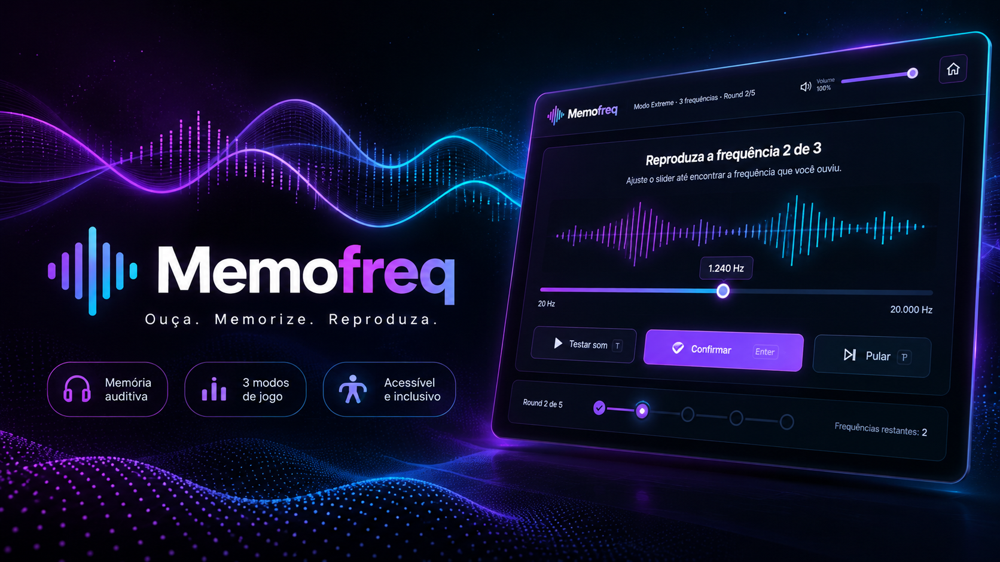
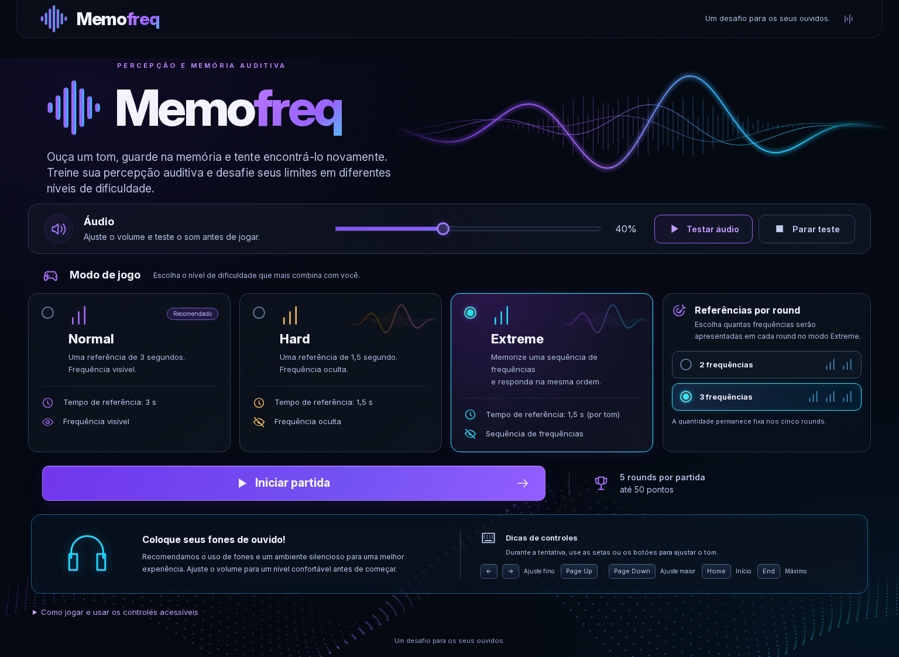
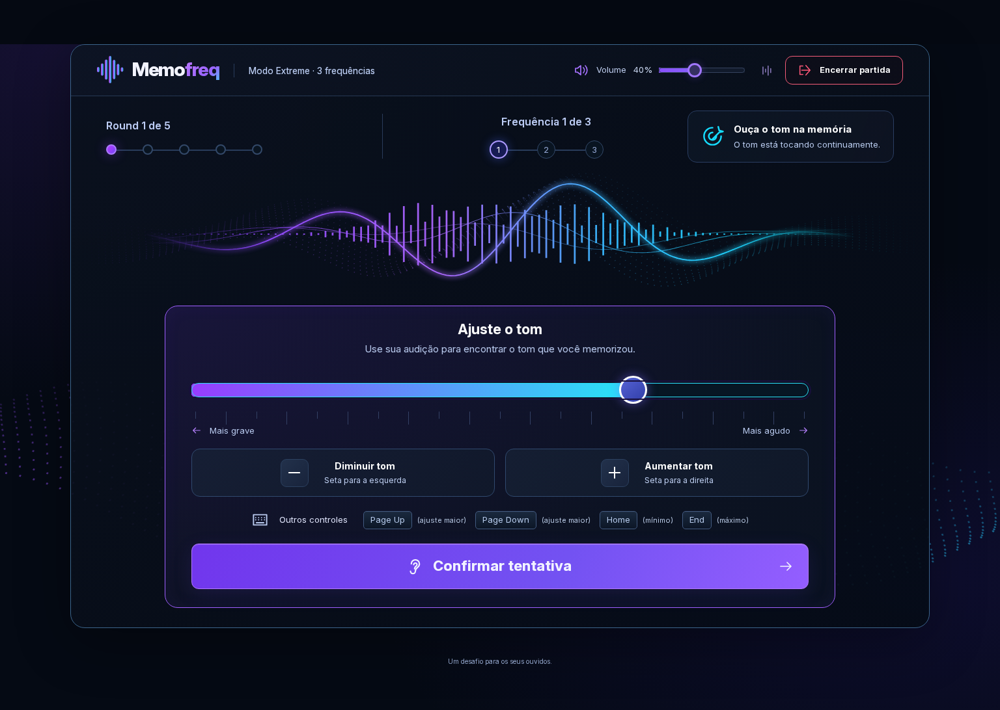
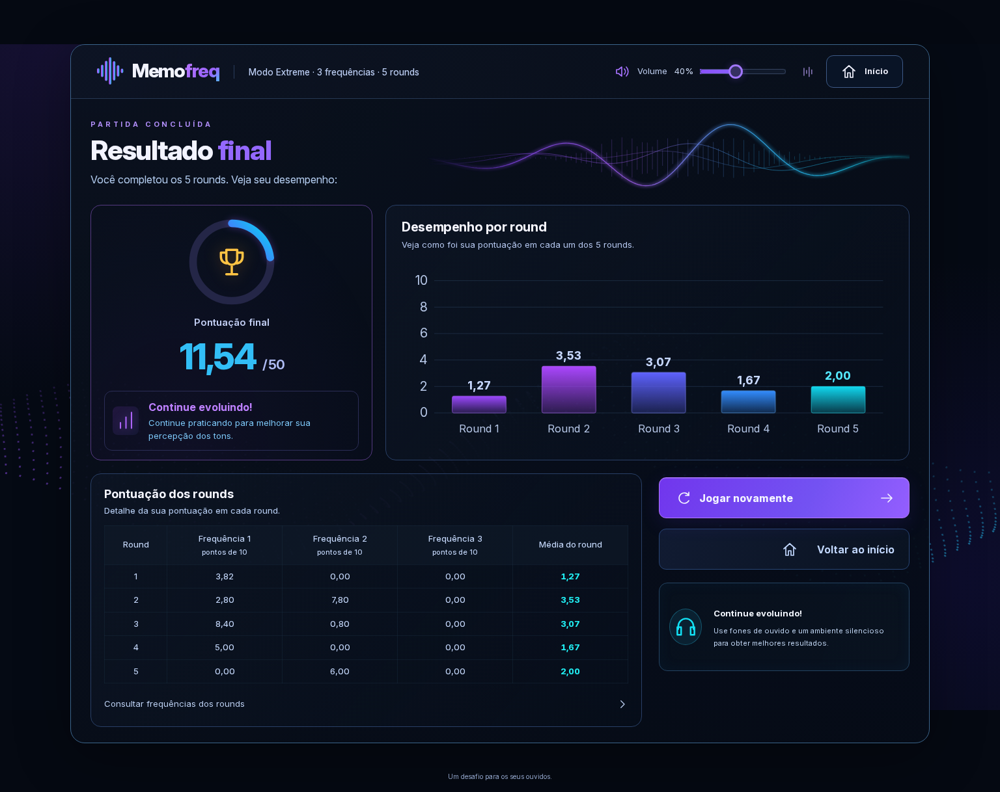

# Memofreq

**Quanto de um som você consegue guardar na memória?**

Memofreq é um jogo de percepção e memória auditiva que roda no navegador. Você escuta um tom, guarda sua altura na memória e tenta encontrá-lo novamente ajustando outro som. O desafio é simples de entender: quanto mais perto você chegar da frequência original, maior será sua pontuação.

**5 rounds · 3 modos de jogo · Até 50 pontos**

## Ouça. Memorize. Reproduza.

1. Escolha um modo, teste o áudio e ajuste o volume. Fones de ouvido ajudam na experiência.
2. Escute a referência uma única vez e ajuste o tom pelo slider, pelo teclado ou pelos botões.
3. Confirme seu palpite, confira o resultado e siga até completar os cinco rounds.

Os tons variam de **80 a 700 Hz**. Cada round vale até **10 pontos**, e a soma dos cinco rounds forma a pontuação final.

## Encontre o seu desafio

| Modo        | O que muda                                                                                                                |
| ----------- | ------------------------------------------------------------------------------------------------------------------------- |
| **Normal**  | Uma referência de 3 segundos por round. A frequência do tom que você ajusta fica visível.                                 |
| **Hard**    | Uma referência de 1,5 segundo por round. A frequência fica oculta durante o palpite.                                      |
| **Extreme** | Duas ou três referências de 1,5 segundo cada. Memorize a sequência e responda na mesma ordem, com as frequências ocultas. |

No **Extreme**, confirmar um palpite leva diretamente ao próximo, sem interromper o tom. Os resultados aparecem juntos ao terminar o round, cuja nota é a média das tentativas.

## Da memória ao resultado

Acompanhe seus palpites, compare as frequências e veja seu desempenho ao longo da partida.

<table>
  <tr>
    <th>Ajuste do tom</th>
    <th>Resultado da partida</th>
  </tr>
  <tr>
    <td></td>
    <td></td>
  </tr>
</table>

## Feito para ouvir

Interface responsiva para desktop e mobile, com navegação por teclado, foco visível, botões alternativos ao slider e controle de animações. Os resultados ficam disponíveis para consulta, e a aplicação evita anúncios automáticos de frequências para preservar a escuta.

Construído com **React**, **TypeScript**, **Vite** e **Web Audio API**, que gera os tons diretamente no navegador.

---

Conceito inspirado no [Dialed Sound](https://dialed.gg/sound), com identidade visual e implementação próprias.
