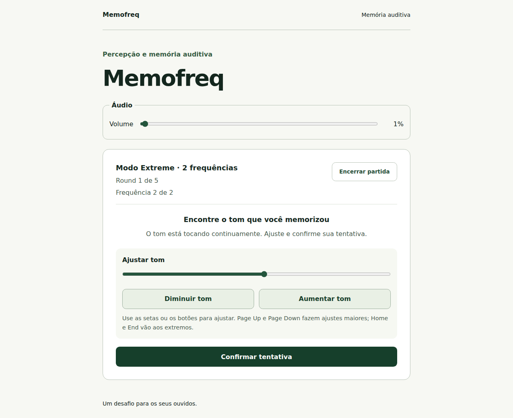
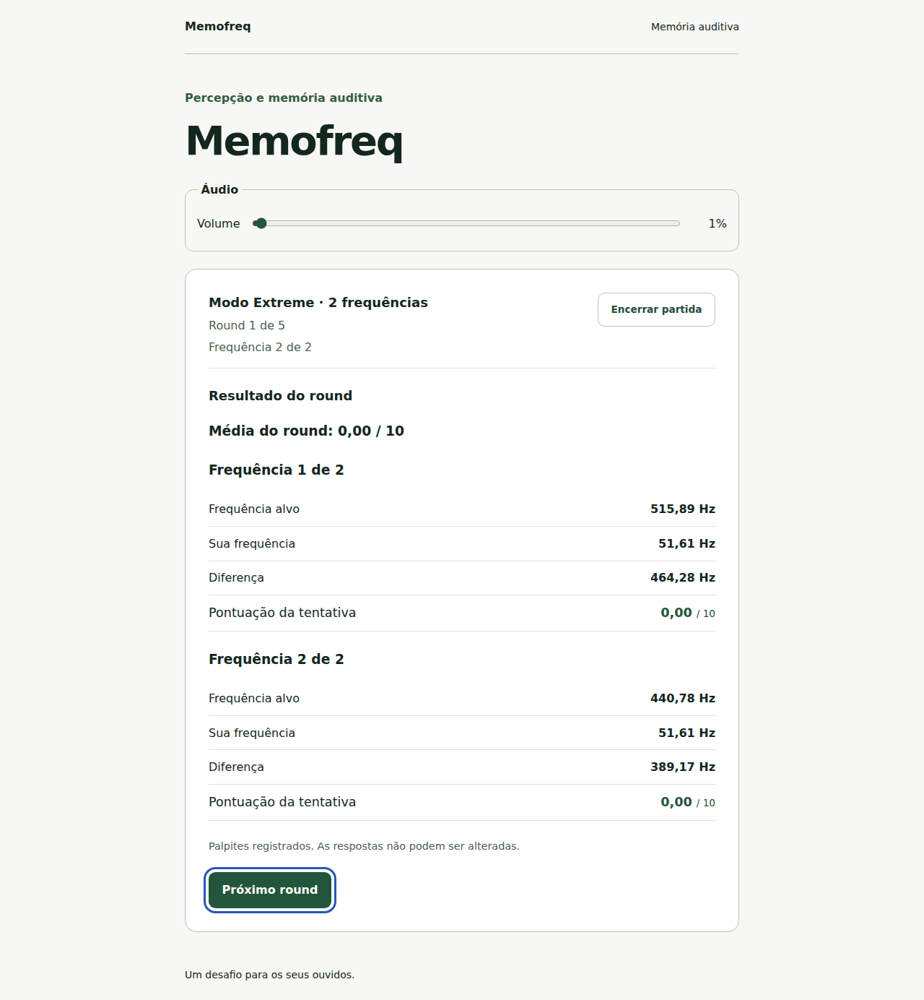
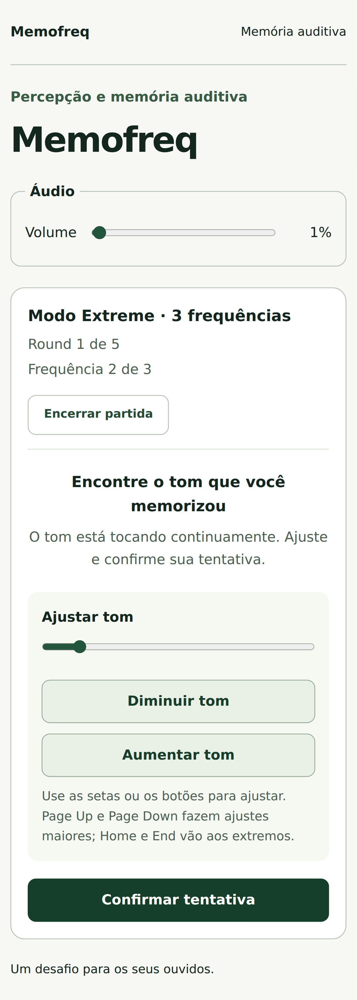
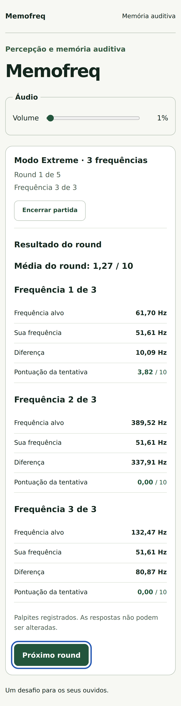

# Correção do Extreme — palpites contínuos e resultado conjunto

Data: 26/10/2026. Correção solicitada após o teste manual do usuário na Fase 5. A Fase 6 permanece sem autorização.

## Comportamento corrigido

No Extreme com duas ou três frequências, a sequência de referências continua sendo ouvida uma única vez. Cada confirmação intermediária registra definitivamente o palpite e passa imediatamente ao seguinte, sorteando uma nova posição válida do slider. A mesma voz contínua permanece ativa e muda suavemente de frequência, sem pausa, tela de resultado, botão de continuar, replay, anúncio da aplicação ou mudança automática de foco.

Somente a última confirmação encerra o tom suavemente e revela o resultado do round. A tela apresenta todas as frequências na ordem original, cada uma com alvo, palpite, diferença em Hz e pontuação, além da média do round. Esse fluxo se repete nos cinco rounds; o total continua sendo a soma das médias, sem arredondamento intermediário.

A ocultação ou suspensão após um palpite intermediário interrompe a partida, pois a próxima tentativa já está ativa. Se a última confirmação foi aceita antes da ocultação, as respostas completas são consolidadas após o encerramento sonoro e preservadas, sem avançar o round automaticamente.

## Implementação

- O reducer registra a resposta atual, valida a posição inicial do próximo alvo e avança o índice em uma única transição `attempt → attempt`. Uma posição inválida rejeita o evento sem registrar uma resposta parcial.
- O controlador usa `setFrequency` na mesma voz, mantendo a suavização existente. Seu callback de término acompanha a identidade do handle, inclusive após mudar o índice da tentativa.
- A confirmação recebe o identificador da execução renderizada; eventos antigos, cliques múltiplos e repetição de tecla não devem registrar o palpite seguinte involuntariamente.
- A etapa `attempt-result` fica restrita à saída sonora após o último palpite. A interface só revela o resultado consolidado do round.
- Os detalhes de cada frequência são apresentados em seções semânticas, fora de regiões vivas e sem foco automático em números. Normal e Hard reutilizam os mesmos detalhes de resultado.
- A preparação intermediária e o comando `NEXT_ATTEMPT` foram removidos. Preparar ou retomar áudio volta a servir apenas à contagem de um round.

Nenhuma dependência, fórmula de pontuação, tempo de referência ou faixa foi alterada. A Web Audio engine existente foi reutilizada.

## Arquivos alterados

```text
src/domain/models.ts
src/domain/gameReducer.ts
src/domain/gameReducer.test.ts
src/domain/README.md
src/application/GameController.ts
src/application/GameController.test.ts
src/application/README.md
src/app/App.tsx
src/app/App.test.tsx
src/ui/components/AttemptResult.tsx
src/ui/components/RoundSummary.tsx
src/ui/styles/global.css
e2e/advanced-modes.spec.ts
AGENTS.md
README.md
docs/functional-spec.md
docs/architecture.md
docs/accessibility.md
docs/audio-engine.md
docs/implementation-plan.md
docs/manual-testing.md
docs/phase-5-report.md
docs/visual-report.md
```

Este relatório e quatro novas capturas são acrescentados à documentação. O relatório original da Fase 5 conserva seu histórico, com um link para esta correção.

## Verificações

- `npm run check` aprovado: ESLint, formatação, TypeScript estrito, build e **172 testes em oito arquivos**.
- Domínio: avanço atômico, resposta imutável, posição inicial válida para o próximo alvo, rejeição de confirmação antiga, médias e soma precisas, interrupção da tentativa seguinte e consolidação de respostas completas mesmo com a página oculta.
- Controlador: mesma voz e ausência de parada entre palpites, ausência de mensagens intermediárias, observação de falhas após mudança de execução e preservação do resultado completo na última confirmação.
- Interface: resultado ausente durante os palpites restantes, slider reposicionado, foco preservado, proteção de confirmação e todos os dados individuais revelados juntos ao final.
- Playwright: **24 casos aprovados em duas execuções**, em Chromium desktop e Pixel 7 emulado. A primeira execução de `npm run test:e2e` aprovou 22 casos em 5,7 minutos, incluindo cinco rounds de cada modalidade, áudio nativo, teclado, resultados conjuntos, duplo clique e interrupções.
- Após o ajuste final para consolidar respostas completas com a página oculta, `npm run test:e2e -- --grep 'ocultar na última confirmação'` aprovou os dois casos adicionais em 15,7 segundos. Essa verificação cobriu a preservação de todos os resultados durante a última cauda sonora.
- Axe sem violações detectadas nas telas exercitadas, incluindo os novos resultados conjuntos do Extreme.
- Quatro capturas preservadas sem edição, com links locais verificados e inspeção visual em desktop e móvel emulado.

Os testes usam os tempos reais do produto, APIs Web Audio nativas e visibilidade controlada por eventos do documento. Não houve teste manual de áudio ou tentativa de operar NVDA pelo agente; essas verificações permanecem com o usuário, conforme sua orientação. Emulação móvel e axe não certificam dispositivos físicos ou fala real de leitores de tela.

## Capturas atualizadas

Capturas reais de testes automatizados, preservadas sem edição. Os valores e notas são exemplos das entradas automatizadas.

### Desktop — segundo palpite sem resultado intermediário



### Desktop — resultados das duas frequências juntos



### Celular emulado — avanço ao segundo palpite



### Celular emulado — resultados das três frequências juntos



## Git e prévia

Repositório privado [MatDev435/Memofreq](https://github.com/MatDev435/Memofreq), branch `main`. Autenticação e identidade do remoto conferidas. Implementação: `502033b` — `fix: keep Extreme guesses continuous until round results`. Este relatório, as especificações atualizadas e as quatro capturas são versionados em um commit documental separado; o estado do envio é informado no resumo da entrega.

A prévia local foi confirmada por HTTP em [http://localhost:5173/](http://localhost:5173/). Recarregue a página e inicie uma nova partida para testar a versão corrigida. Os próximos testes manuais com NVDA e a escuta humana permanecem a cargo do usuário. A próxima fase de implementação continua exigindo autorização explícita.
