# Relatório do multiplayer — backend e frontend

Trabalho autorizado em 03/11/2026 na branch `feat/multiplayer-backend`, sem merge, PR ou publicação. O backend está descrito em `server/README.md` e o contrato em `multiplayer-protocol.md`; este relatório registra o frontend, a integração e as verificações.

## Telas e funcionalidades

| Backend                          | Interface                                                                                                 |
| -------------------------------- | --------------------------------------------------------------------------------------------------------- |
| Criar sala / entrar com apelido  | Cartão **Multiplayer** na inicial, tela de entrada com apelido, “Criar sala” e código                     |
| Link de convite                  | `#sala=<código>` abre a entrada com o código preenchido; o lobby mostra código, link e “Copiar convite”   |
| Erros de entrada                 | Mensagem em `role="alert"`, foco no campo relacionado, apelido e código preservados                       |
| `set-mode`, `start-match` (host) | `ModeSelector` existente no lobby; somente leitura para quem não é host; “Iniciar partida” só para o host |
| `kick` (host, qualquer fase)     | “Remover” com confirmação em duas etapas no lobby, prontidão, espera e resultados                         |
| `ready`                          | “Estou pronto” / “Pronto para o round N”, que também habilita o áudio; lista de prontos                   |
| `playing` + `currentRound`       | Tela de jogo existente: contagem, referências, slider, botões, confirmação e visibilidade de Hz por modo  |
| `submit-guess`                   | Um envio por tentativa; no Extreme a voz continua com a próxima posição inicial do servidor               |
| `progress`                       | Tela de espera com quem concluiu, joga ou perdeu o round, sem palpites ou notas                           |
| `forfeit-round`                  | Política de interrupção abaixo e “Desistir deste round”                                                   |
| `lastRound`                      | Cards do próprio resultado (componentes do single-player) e tabela de todos os participantes              |
| `ranking`, `rounds`              | Ranking com posição, empates, destaque próprio, tabela dos cinco rounds e frequências sob demanda         |
| `play-again` (host)              | “Jogar novamente” só para o host; os demais veem que aguardam o host                                      |
| `leave`, fatais, quedas          | “Sair da sala” no cabeçalho, tela de saída com motivo, “Entrar em outra sala” e “Voltar ao menu”          |
| Troca de host                    | Permissões e controles atualizados automaticamente e anúncio “Você agora é o host da sala.”               |

## Arquitetura do cliente

- `src/multiplayer/config.ts` lê e valida `VITE_MULTIPLAYER_URL` (somente `ws:`/`wss:`); sem ela o cartão aparece como indisponível.
- `src/multiplayer/protocol.ts` reexporta tipos, códigos e normalizadores de `server/src`; não há cópia do contrato.
- `RoomConnection` encapsula um WebSocket por sessão, ping a cada 25 s e nenhuma reconexão; mensagens e fechamentos tardios são ignorados.
- `MultiplayerController` espelha o estado autoritativo (versões antigas são descartadas), envia comandos e executa localmente o round com a `WebAudioEngine` existente. O cliente não sorteia alvos nem calcula notas ou ranking.
- `MultiplayerApp` mapeia o snapshot para telas em `src/ui/multiplayer` e reaproveita `SessionHeader`, `ModeSelector`, `PlayingScreen`, `ToneControl`, `GameProgress`, `AttemptResult`, `ScoreRing` e os estilos existentes. O single-player usa o mesmo `GameController`, reducer e engine, sem mudanças de comportamento.

## Política de interrupção (somente multiplayer)

| Momento                                                                                                 | Ocultar a página ou perder o áudio                                                                                                             | Penalidade    |
| ------------------------------------------------------------------------------------------------------- | ---------------------------------------------------------------------------------------------------------------------------------------------- | ------------- |
| Antes de qualquer referência (preparação, contagem, round liberado com a aba oculta ou áudio bloqueado) | Contagem cancelada; “Começar round” recomeça os 3 s                                                                                            | Nenhuma       |
| Durante as referências                                                                                  | `forfeit-round`: o round vale zero, sem replay                                                                                                 | Round perdido |
| Durante o ajuste                                                                                        | Tom silenciado e tentativa suspensa; “Retomar tentativa” volta à mesma frequência, sem repetir a referência; palpites confirmados são mantidos | Nenhuma       |
| Espera, resultados, lobby, final                                                                        | Sem efeito                                                                                                                                     | Nenhuma       |

“Desistir deste round” envia `forfeit-round` por decisão explícita quando o round está suspenso ou aguardando início. Uma breve troca de aba durante o ajuste não penaliza.

## Acessibilidade

- Foco: título de cada tela (sem números) ao entrar; “Sair da sala” antes da contagem; “Começar round”/“Retomar tentativa” nas pausas; nenhum foco durante tons. O botão de prontidão usa `aria-disabled` e mantém o foco após o clique. A remoção move o foco para “Confirmar remoção de …” e volta ao cancelar.
- Região viva polida e curta: entradas, saídas, prontidão, conclusão de outros participantes, troca de host, modo alterado e mudanças de etapa. Ela fica vazia durante preparação, contagem, referências, ajuste e cauda; nunca contém Hz ou notas.
- Hz permanece oculto no Hard e Extreme durante as tentativas; o slider mantém “Ajustar tom” e “Ajuste pelo som”.
- Listas e tabelas têm nomes acessíveis; tabelas com rolagem horizontal são regiões focáveis; o código da sala, o link e o status da cópia são texto.

## Verificações executadas em 03/11/2026

| Verificação                                         | Resultado                                                                                                                 |
| --------------------------------------------------- | ------------------------------------------------------------------------------------------------------------------------- |
| `npm run check`                                     | 342 testes (192 anteriores do jogo, 92 do servidor, 58 do cliente multiplayer), lint, formatação, tipos e build aprovados |
| `npm run test:server`                               | 17 testes de integração do protocolo aprovados                                                                            |
| E2E completos em Chromium desktop e Pixel 7 emulado | 42 testes aprovados: 15 existentes e 6 multiplayer em cada perfil, com o Worker local na porta 8797                       |
| E2E multiplayer repetidos                           | 6/6 em cada perfil Chromium em três execuções completas, sem falhas intermitentes                                         |
| axe nas telas multiplayer                           | Sem violações em lobby (host e convidado), prontidão, espera, resultados, ranking e saída                                 |
| Reflow                                              | Entrada, lobby e prontidão a 320 px com texto a 200%, sem rolagem horizontal                                              |

Firefox e WebKit não foram executados localmente: o ambiente temporário de bibliotecas e áudio virtual das fases anteriores não existia mais. A CI executa os quatro perfis, inclusive os cenários multiplayer, mas ainda não rodou nesta branch. NVDA e outros leitores não foram operados pelo agente; os casos manuais estão em `manual-testing.md`.

## Problemas encontrados e corrigidos

- Retomar uma tentativa suspensa passava por uma etapa de preparação; ocultar a página nesse instante a transformaria em início de round e repetiria a referência. A retomada agora mantém a tentativa suspensa até o áudio voltar.
- Um estilo de rótulo do multiplayer alterava os cards do `ModeSelector`; foi restrito aos campos multiplayer.
- `overflow-wrap: anywhere` global quebrava números das tabelas no mobile; células numéricas não quebram e a tabela rola horizontalmente.
- O anúncio “Partida iniciada…” permanecia na região viva durante o tom; ela é limpa ao entrar em etapas com som.
- O foco não chegava a “Começar round” porque o botão era desabilitado com a página oculta.
- O cartão da inicial ultrapassava 320 px com texto a 200%.
- Recusas de entrada não recebiam o fechamento quando aceitas pela API de hibernação (correção do backend, registrada no guia do servidor).

## Evidências visuais

Capturas reais dos E2E em `images/multiplayer/` (pixels CSS):

| Desktop                                                                                          | Mobile                                                                                          |
| ------------------------------------------------------------------------------------------------ | ----------------------------------------------------------------------------------------------- |
| 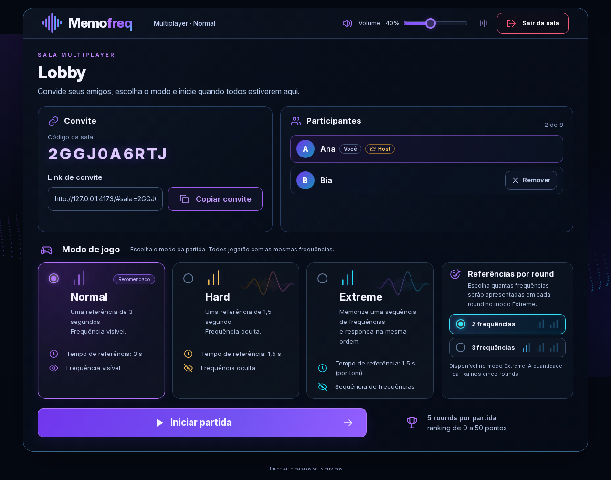 | 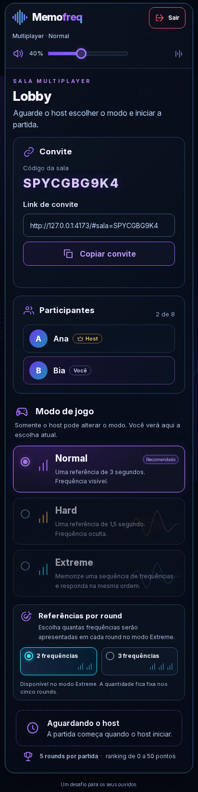    |
| 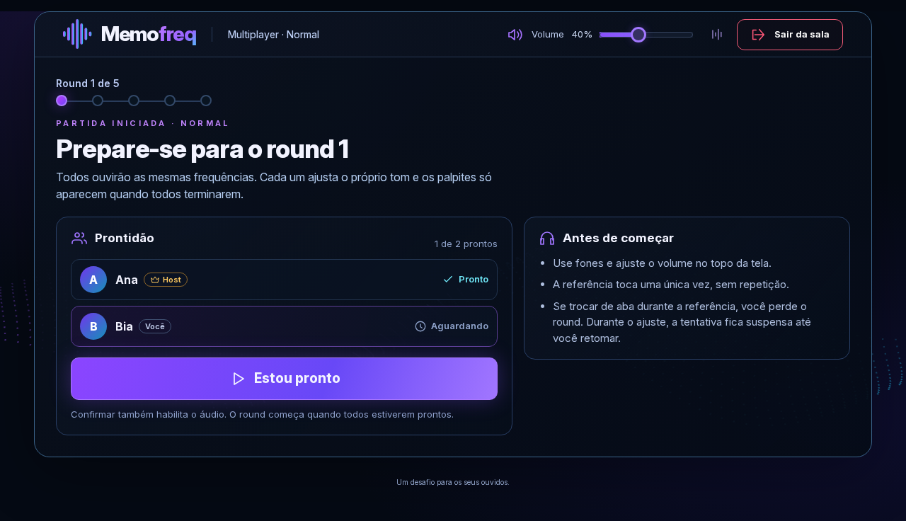                                 | 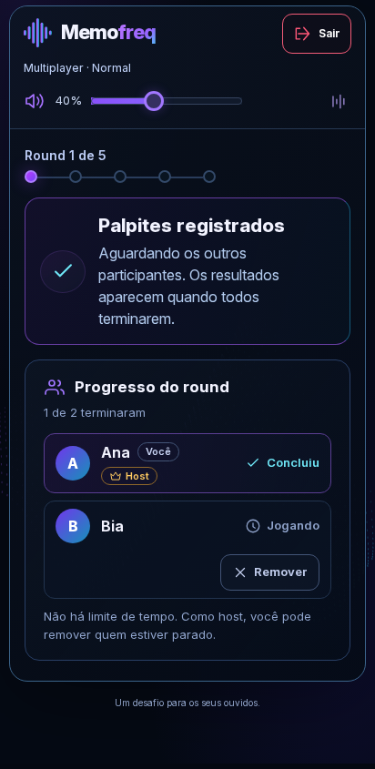        |
| 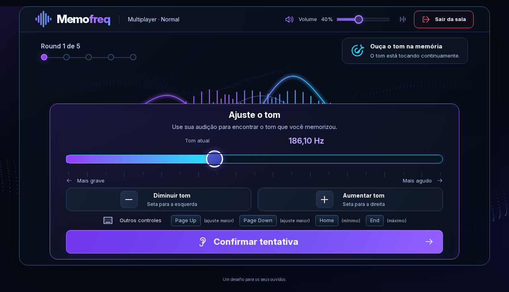              | 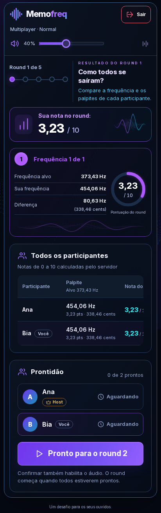         |
| 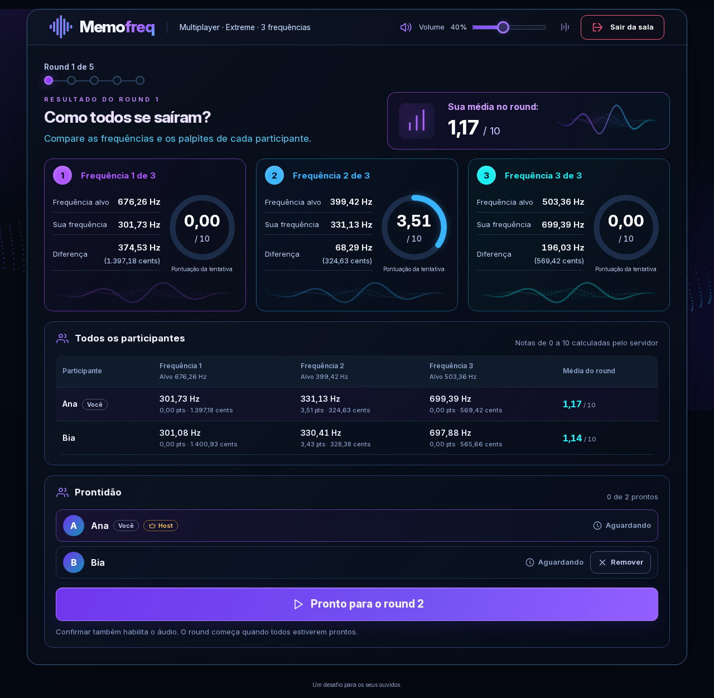 | 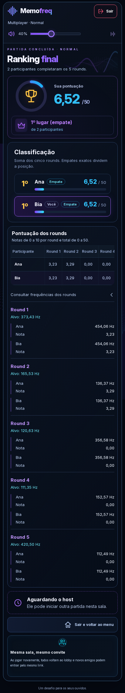                     |
| 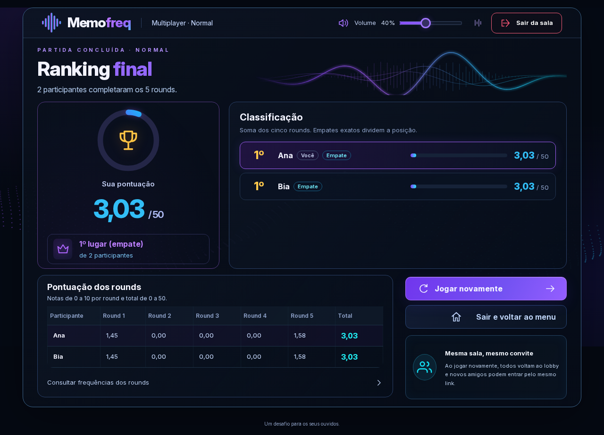                           | 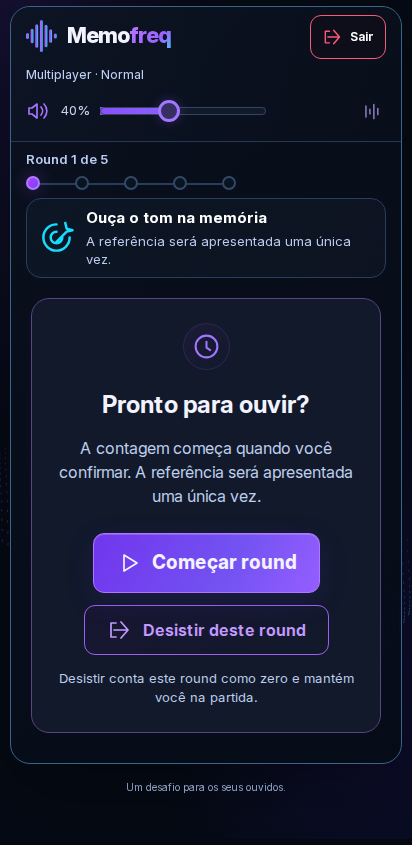 |
| 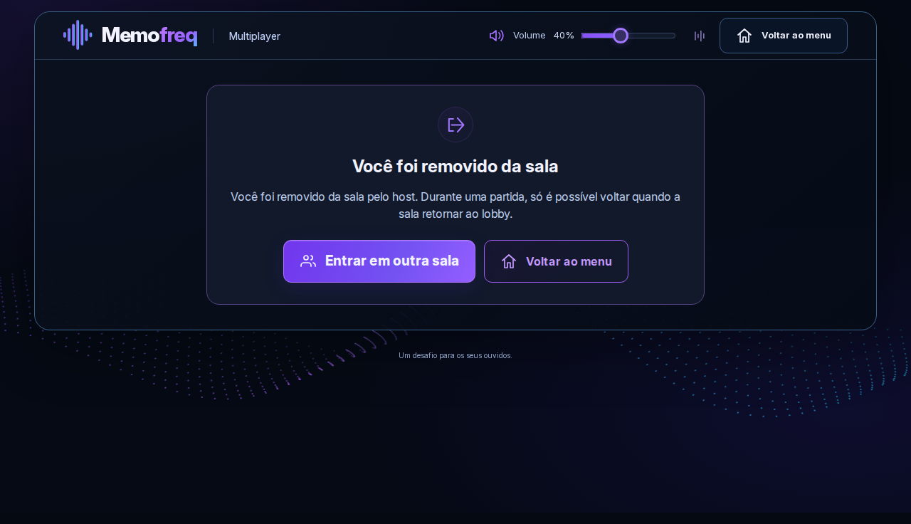                     | 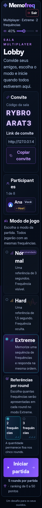         |

Também foram capturadas a inicial com o cartão Multiplayer (`mobile-01-home.png`), a espera e os resultados do host em desktop.

## Limitações conhecidas

- O alvo do round vigente chega ao navegador e pode ser inspecionado (aceito).
- Sem reconexão: recarregar, fechar ou perder a conexão tira o participante da sala; durante a partida ele só volta quando a sala retornar ao lobby.
- Quedas silenciosas levam de 75 a 105 s para serem detectadas pelo servidor; o host pode remover antes.
- Retomar uma tentativa move o foco para “Sair da sala” no instante em que o tom recomeça, como no início da contagem; a fala real com NVDA precisa de validação manual.
- O fechamento iniciado pelo servidor em outra conexão chega cerca de 10 s depois no `workerd` local; o cliente encerra ao receber o erro fatal.
- Firefox, WebKit e dispositivos físicos ainda não foram testados localmente.
