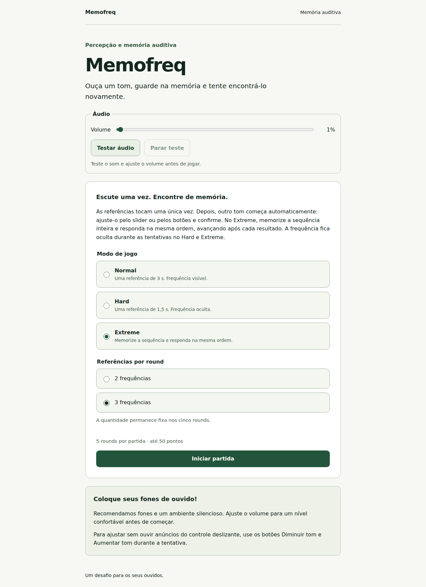
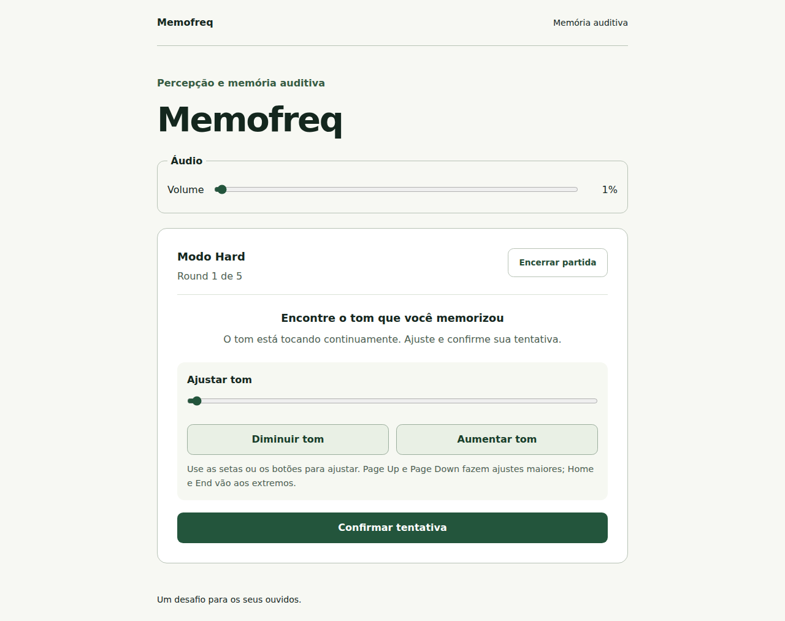
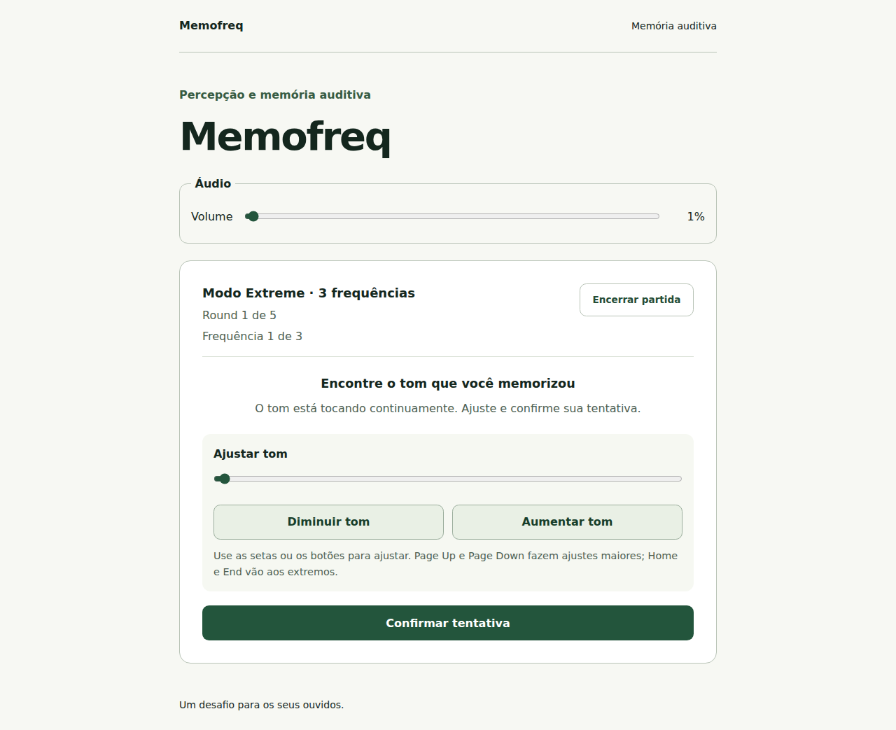
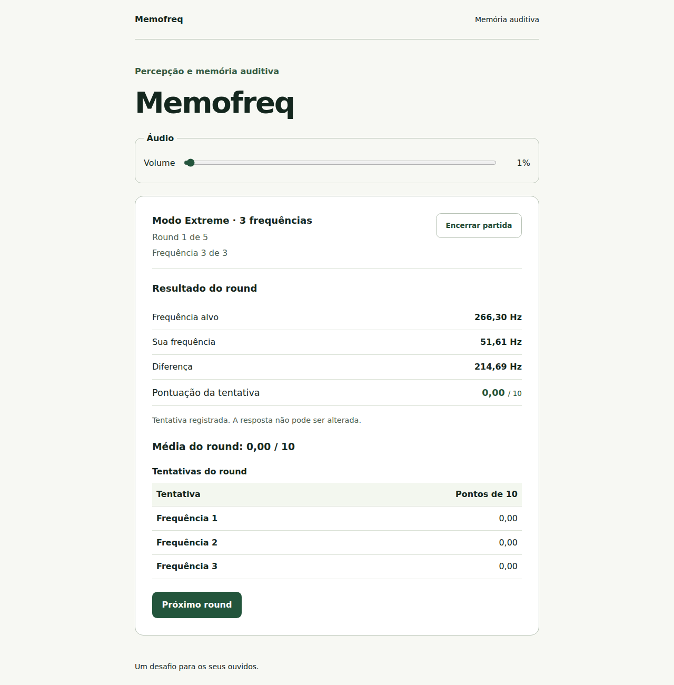
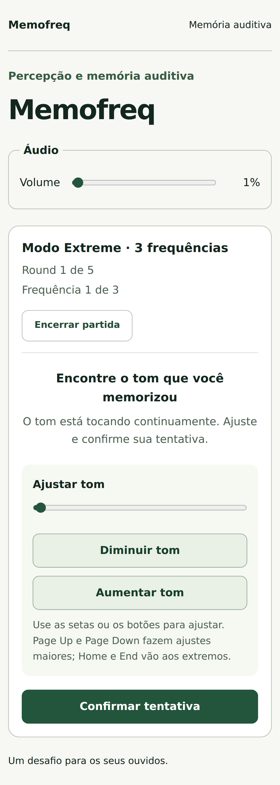
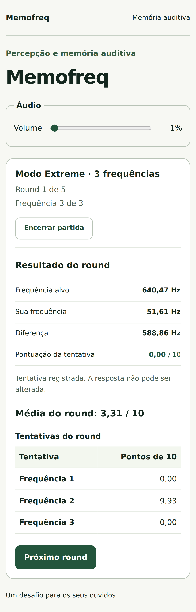

# Relatório da Fase 5 — Hard e Extreme

Data: 26/10/2026. Fase autorizada pelo usuário após testar a interface Normal e relatar funcionamento, inclusive com NVDA. A Fase 6 não foi iniciada. O acabamento visual definitivo permanece posterior.

## Entregas

- Seleção de Normal, Hard ou Extreme na tela inicial; no Extreme, escolha de duas ou três referências antes da partida, fixa nos cinco rounds.
- Hard com referência de 1,5 s e frequência oculta durante o ajuste.
- Extreme com sequência inteira de duas ou três referências de 1,5 s, pausas de 300 ms e respostas na ordem original.
- Início automático do tom contínuo após a sequência; novas posições iniciais válidas em cada tentativa, a pelo menos 300 cents do alvo.
- Resultado individual após cada confirmação e avanço explícito à próxima tentativa, sem contagem adicional nem replay.
- Média do round após a última resposta, tabela de notas individuais e total dos cinco rounds calculados pelo domínio, sem arredondamento intermediário.
- Reinício preservando modalidade e quantidade, com novos sorteios; retorno à inicial conserva a seleção.
- Preparação e retomada explícita entre tentativas, inclusive após ocultação, falha de habilitação ou substituição de contexto fechado; resultados já confirmados permanecem válidos.

O domínio, as regras, os tempos e a engine existentes foram reutilizados. Nenhuma dependência foi adicionada. Gráfico, acabamento definitivo, backend e persistência permanecem fora desta entrega.

## Acessibilidade e teste informado pelo usuário

O mesmo slider nativo e os botões alternativos atendem às quatro modalidades. O nome é “Ajustar tom”, o valor nativo continua normalizado e `aria-valuetext` permanece constante. No Hard e Extreme, o elemento de leitura de Hz é omitido do DOM durante as tentativas, sem equivalente em rótulos, descrições ou tooltips.

A sequência não publica mensagens por tom. A região viva fica vazia durante a escuta e o ajuste. Valores são revelados em texto comum, após a cauda sonora, para consulta sob demanda. As ações de continuar recebem foco sem incluir Hz ou notas no nome; a próxima tentativa começa automaticamente após preparar o áudio.

O usuário relatou funcionamento da versão Normal com NVDA em 26/10/2026 e assumiu os próximos testes manuais. Esse relato está registrado em [testes manuais](manual-testing.md) e [acessibilidade](accessibility.md). O agente não tentou operar o NVDA nesta fase. A escuta humana e a fala dos novos modos aguardam a avaliação do usuário; os testes automatizados não as substituem.

## Arquivos

Criados:

```text
src/ui/components/ModeSelector.tsx
src/ui/components/RoundSummary.tsx
e2e/advanced-modes.spec.ts
docs/phase-5-report.md
docs/images/phase-5/*.png
```

Atualizados:

```text
src/application/GameController.ts
src/application/GameController.test.ts
src/application/README.md
src/app/App.tsx
src/app/App.test.tsx
src/ui/components/ToneControl.tsx
src/ui/components/AttemptResult.tsx
src/ui/styles/global.css
AGENTS.md
README.md
docs/functional-spec.md
docs/architecture.md
docs/accessibility.md
docs/audio-engine.md
docs/implementation-plan.md
docs/manual-testing.md
docs/phase-4-report.md
docs/visual-report.md
```

`start(selection)` generaliza o início da partida e `restart()` lê a seleção da sessão encerrada. A sequência usa um único handle de reprodução. A preparação de tentativas subsequentes passa por `AUDIO_READY` com destino explícito, sem voltar às referências. O domínio continua responsável por aceitar eventos, preservar respostas e calcular as médias.

## Verificações executadas

- `npm run check` aprovado: ESLint, Prettier, TypeScript estrito, build e **168 testes em oito arquivos**.
- Controlador e interface: cinco rounds dos três novos perfis, ordem, frequência inicial, bloqueio de alteração de modalidade, confirmações duplicadas, precisão das médias e soma, seleção no reinício, ocultação e retomada entre tentativas.
- Regressão do Normal e das suites existentes preservada.
- `npm run test:e2e`: **20 testes aprovados em 5,6 minutos**, em Chromium desktop e Pixel 7 emulado, incluindo cinco rounds completos de cada um dos quatro perfis.
- Web Audio nativa: duração de 1,5 s, pausas de 300 ms, ordem, distância inicial, um contexto reutilizado, uma voz por tentativa e liberação de recursos.
- Interrupção durante a pausa do Extreme cancela osciladores futuros antes do início; resultados individuais sobrevivem à ocultação e o avanço não repete referências.
- Axe sem violações detectadas na inicial e nas tentativas/resultados finais exercitados; navegação, foco e ausência de Hz nas tentativas verificados no DOM e na semântica acessível.
- Capturas desktop e móvel emulado inspecionadas; seis imagens preservadas sem alteração, com referências locais verificadas.

Os testes de navegador observam osciladores e agendamentos Web Audio nativos, sem alterar os tempos do produto. Mudanças de visibilidade são provocadas por eventos controlados. A emulação Pixel 7 não equivale a um aparelho físico.

## Capturas da interface

Capturas reais do build, produzidas pelos testes Playwright. Os ajustes, volumes e notas são entradas e resultados automatizados, sem avaliação humana de desempenho. A aparência ainda é a interface funcional para refinamento posterior.

### Seleção de modalidade e quantidade — desktop



### Hard — tentativa com frequência oculta



### Extreme — tentativa em desktop



### Extreme — média e notas do round em desktop



### Extreme — tentativa em celular emulado



### Extreme — resultado em celular emulado



## Prévia local

A prévia anterior não estava em execução. Foi iniciado `npm run dev -- --port 5173 --strictPort` e confirmado por HTTP que a porta serve a interface atualizada. Acesse [Memofreq local](http://localhost:5173/), selecione Hard ou Extreme e use os controles existentes. O servidor foi deixado em execução para os testes do usuário.

## Git e continuidade

Repositório privado: [MatDev435/Memofreq](https://github.com/MatDev435/Memofreq), branch `main`. Autenticação e identidade do remoto conferidas antes da sincronização.

- `cec396f` — `feat: add playable Hard and sequential Extreme modes`.
- Documentação, registro do teste informado pelo usuário e seis capturas são versionados em um commit documental separado.

A entrega acompanha `origin/main`, sem push forçado. O estado do envio e da execução remota é informado no resumo da entrega; o histórico pode ser consultado no repositório.

A CI está disponível em [GitHub Actions — Quality](https://github.com/MatDev435/Memofreq/actions/workflows/ci.yml). A próxima etapa prevista é a Fase 6, com gráfico e revisão conjunta, somente mediante autorização. Os próximos testes manuais com leitores de tela permanecem a cargo do usuário.
