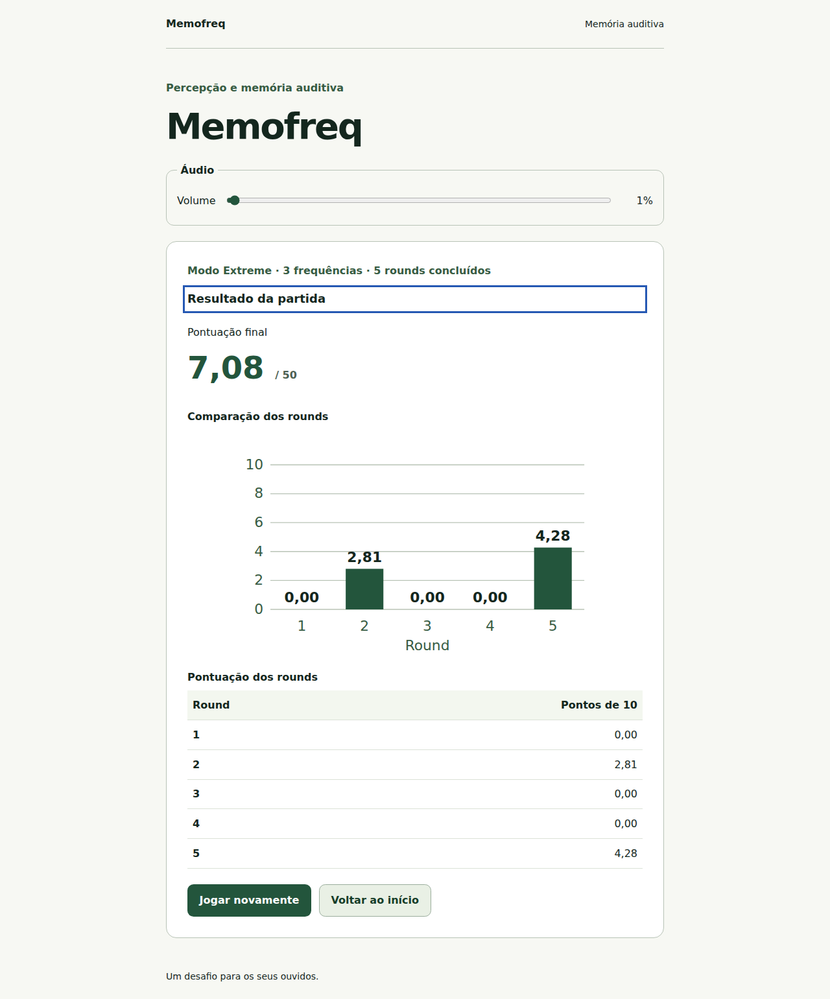
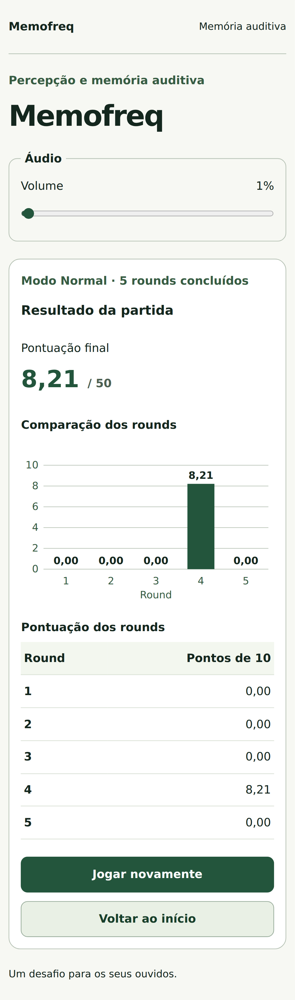
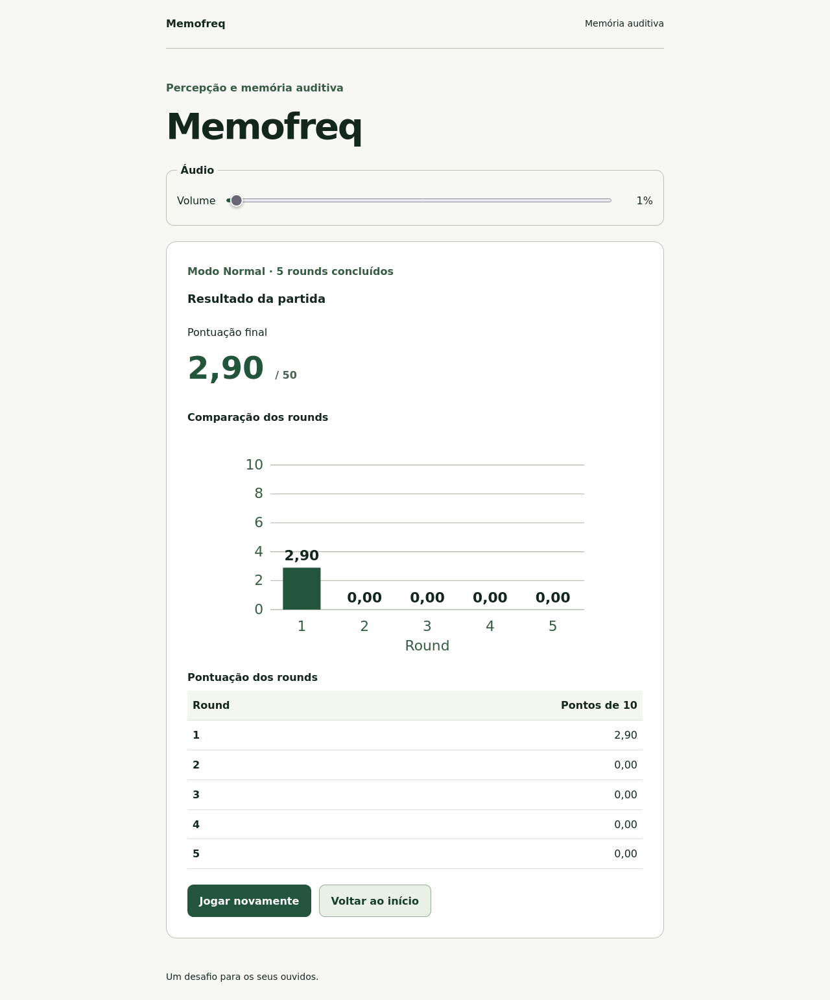
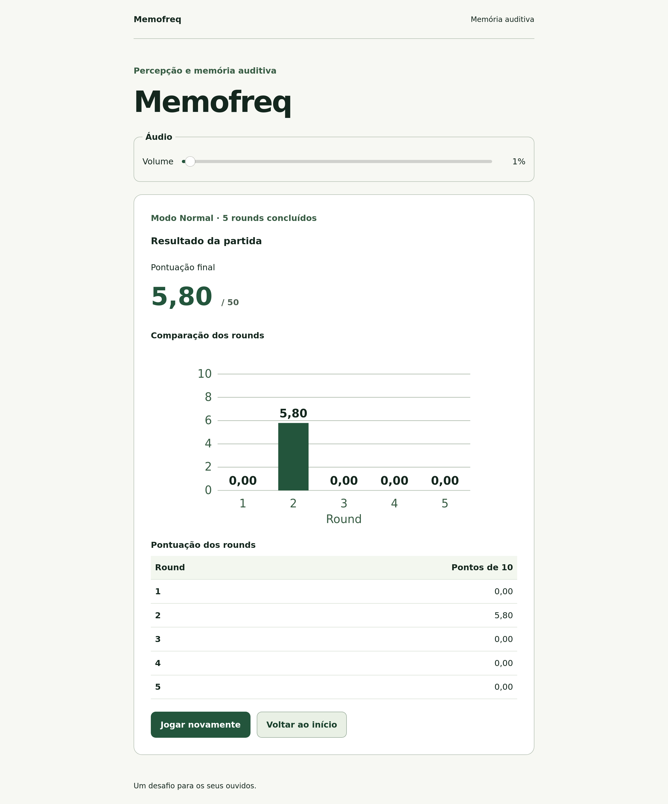
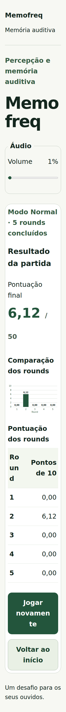

# Relatório da Fase 6 — Integração e qualidade

Data: 26/10/2026. Fase autorizada após o usuário testar e aprovar a correção do Extreme. O acabamento visual definitivo permanece uma etapa posterior.

## Entregas

- Gráfico SVG dos cinco rounds em todas as modalidades, com eixo fixo 0–10, notas nos rótulos e tabela equivalente.
- Gráfico e tabela usam os mesmos resultados imutáveis. As alturas preservam a precisão; somente rótulos e células usam duas casas em pt-BR. O total continua sendo calculado pelo domínio.
- Título e descrição acessíveis do gráfico, tabela para consulta sob demanda e preservação da política de fala: não há região viva, foco numérico automático ou anúncio de frequências no resultado.
- Correção de reflow a 320 px com texto ampliado a 200%: quebra de textos longos, volume em duas linhas no celular, resultados que podem quebrar por campo e números da tabela preservados juntos.
- Suíte ampliada para Chromium desktop, Pixel 7 emulado, Firefox e WebKit Linux, com dois workers.
- Verificação do build estático em `/memofreq/`, sem servidor Vite ou fallback, incluindo áudio, assets e recarga.
- CI com instalação dos três browsers e uma saída virtual de áudio para testes sem dispositivo físico.
- Registro do teste positivo do usuário para o fluxo corrigido do Extreme e roteiro manual atualizado.

O domínio, a pontuação, os tempos, o comportamento contínuo do Extreme e a engine foram preservados. Nenhuma dependência da aplicação foi adicionada.

## Arquivos

Criados:

```text
src/ui/components/RoundScores.tsx
src/ui/components/RoundScores.test.tsx
e2e/results-checks.ts
e2e/layout.spec.ts
e2e/deployment.spec.ts
e2e/static-server.ts
docs/deployment.md
docs/phase-6-report.md
docs/images/phase-6/*.png
```

Atualizados: composição e testes de `App`, CSS, testes E2E de Normal/Hard/Extreme, configuração do Playwright e CI, README, AGENTS, especificação, arquitetura, acessibilidade, plano, checklist manual e relatórios de continuidade.

## Verificações

| Verificação             | Resultado                                                                                      |
| ----------------------- | ---------------------------------------------------------------------------------------------- |
| `npm run check`         | Lint, formatação, TypeScript e build aprovados                                                 |
| Vitest                  | 174 testes aprovados em nove arquivos                                                          |
| Geometria do gráfico    | Notas zero, intermediárias e dez; eixo fixo mesmo com notas baixas; alturas sem arredondamento |
| Tabela equivalente      | Cinco linhas, mesmos valores dos rótulos e consulta fora de regiões vivas                      |
| Build estático e reflow | Oito casos iniciais aprovados nos quatro perfis, antes da revisão completa                     |
| Suíte E2E completa      | 56 casos aprovados em 6,4 minutos, com dois workers e quatro perfis de navegador               |

Após a inspeção das capturas, o último ajuste ficou restrito aos espaçamentos de CSS em telas estreitas. Os oito casos afetados de inicial e resultado com texto ampliado foram repetidos nos quatro perfis e passaram em 1,5 minuto, depois de um novo `npm run check` aprovado. Essa repetição não aumenta a contagem de 56 casos únicos.

A suíte de partidas compara gráfico, tabela e total, preservando a tolerância de arredondamento apenas na apresentação. Também verifica foco final sem números, resultado preservado ao ocultar, recursos de áudio liberados, reinício e retorno à inicial. Os testes mantêm as durações reais do produto.

## Matriz de compatibilidade

| Ambiente automatizado       | Versão do navegador empacotada pelo Playwright | Escopo                                                                       |
| --------------------------- | ---------------------------------------------- | ---------------------------------------------------------------------------- |
| Chromium desktop Linux      | 156.0.8078.4                                   | Fluxos, áudio nativo/offline, gráfico, teclado, axe, reflow e build estático |
| Pixel 7 emulado em Chromium | 156.0.8078.4                                   | Mesmos casos em viewport móvel emulada                                       |
| Firefox Linux               | 157.0                                          | Mesmos casos em engine independente                                          |
| WebKit WPE Linux            | 27.2                                           | Mesmos casos na engine WebKit automatizada                                   |

WebKit Linux não certifica Safari macOS/iOS. Emulação Pixel 7 não certifica Android físico. Zoom real, gestos, latência física e escuta humana permanecem avaliações separadas.

O usuário relatou funcionamento do Normal com NVDA anteriormente e agora confirmou o fluxo corrigido do Extreme. Não informou versões, navegador ou quantidade de referências desse último teste. Os próximos testes manuais com leitores de tela continuam a cargo dele; o agente não tentou operar NVDA, VoiceOver ou TalkBack nesta fase.

## Preparação temporária do ambiente

Firefox iniciou com as bibliotecas disponíveis, mas WebKit precisava de bibliotecas adicionais. Pacotes Ubuntu foram baixados com `--download-only` e extraídos em `/tmp/memofreq-browser-libs/root`, sem instalação no sistema.

O wrapper do WebKit baixado em `/tmp/memofreq-playwright` sobrescrevia `LD_LIBRARY_PATH`; somente esse wrapper temporário foi ajustado para conservar o caminho adicional. A checagem de dependências do Playwright consulta o cache global do linker e não enxerga essas bibliotecas temporárias: apenas nesta execução local, foi usado `PLAYWRIGHT_SKIP_VALIDATE_HOST_REQUIREMENTS=1`, após conferir as bibliotecas e executar os browsers. A CI usa a instalação padrão, sem esse ajuste.

O ambiente também não tinha dispositivo de áudio. Um PulseAudio temporário com saída nula, relógio em tempo real e socket local privado em `/tmp/memofreq-pulse/runtime/native` permitiu AudioContext nativo em Firefox e WebKit. Plugins GStreamer e bibliotecas foram extraídos em `/tmp`. Os relógios nativos foram observados em execução; os tons não foram ouvidos por uma pessoa. O servidor de áudio de teste não modifica a saída das aplicações do usuário. Seu socket é restrito ao diretório temporário do teste. Ao terminar as verificações, esse servidor virtual foi encerrado; os servidores temporários de build foram encerrados pelo Playwright.

Variáveis usadas no ambiente temporário:

```sh
export PLAYWRIGHT_BROWSERS_PATH=/tmp/memofreq-playwright
export LD_LIBRARY_PATH=/tmp/memofreq-browser-libs/root/usr/lib/x86_64-linux-gnu:/tmp/memofreq-browser-libs/root/usr/lib/x86_64-linux-gnu/pulseaudio
export PLAYWRIGHT_SKIP_VALIDATE_HOST_REQUIREMENTS=1
export PULSE_SERVER=unix:/tmp/memofreq-pulse/runtime/native
export GST_PLUGIN_PATH=/tmp/memofreq-browser-libs/root/usr/lib/x86_64-linux-gnu/gstreamer-1.0
```

Os arquivos de `/tmp` são transitórios. Em outro ambiente, use a instalação padrão descrita no [guia de hospedagem e testes](deployment.md). Nenhum pacote de áudio de sistema é uma dependência npm do jogo.

## Capturas e inspeção

Seis capturas de testes reais são preservadas sem edição. Os valores e entradas são automatizados; não representam o acabamento visual definitivo ou avaliação humana de desempenho. Uma nota zero tem altura zero e mantém seu rótulo no eixo; o gráfico não cria barras artificiais nem reescala notas baixas.

### Normal em desktop


### Extreme com três frequências em desktop



### Normal no celular emulado



### Firefox Linux



### WebKit Linux



### Reflow a 320 px com texto ampliado a 200%



## Git, publicação e continuidade

Repositório privado [MatDev435/Memofreq](https://github.com/MatDev435/Memofreq), branch `main`. Commits de implementação e qualidade:

- `29eae70` — `feat: add accessible round score chart and responsive results`.
- `bb9bacc` — `test: validate static hosting and game flows across browser engines`.
- Documentação, registro dos testes e seis capturas são versionados em um commit documental separado.

Autenticação e identidade do remoto foram conferidas. O resultado da sincronização e da CI é informado no resumo da entrega. A prévia existente foi confirmada por HTTP com a composição atualizada em [http://localhost:5173/](http://localhost:5173/) e permanece em execução para o usuário. Recarregue a página antes do próximo teste manual.

O [guia de hospedagem](deployment.md) documenta o artefato. A validação local de um build estático não configura hospedagem remota; nenhum site foi publicado. O acabamento definitivo e funcionalidades futuras continuam dependendo de nova autorização.
