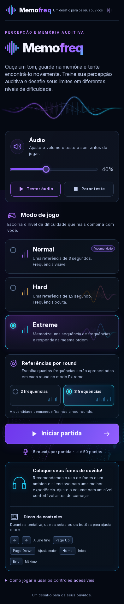
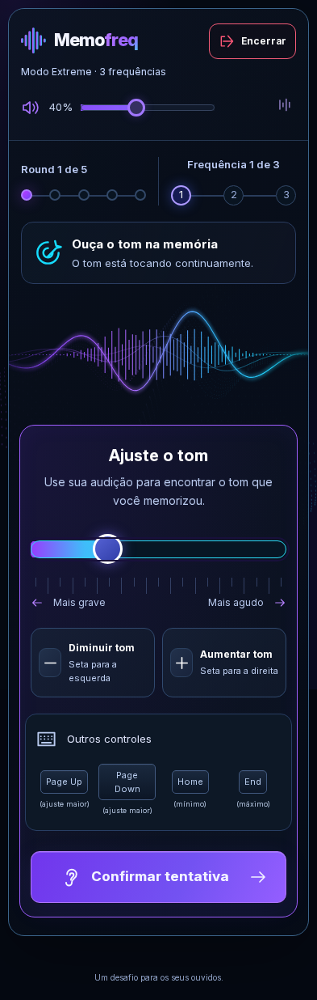
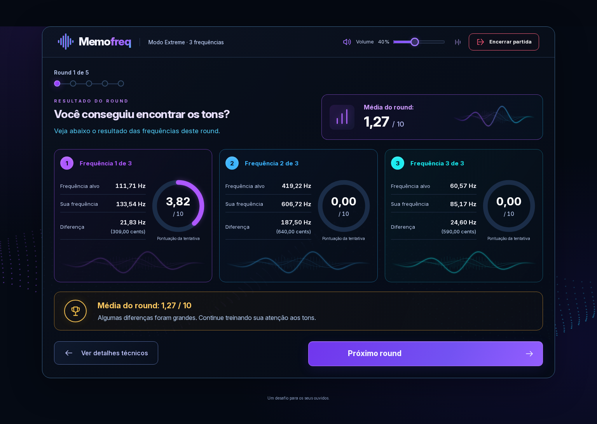
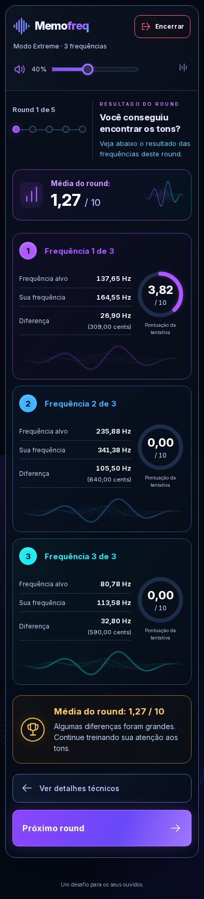
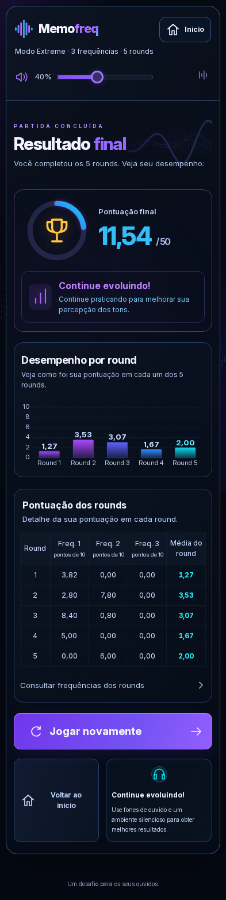

# Relatório da Fase 7 — Redesign completo

Data: 26/10/2026. Desenvolvimento autorizado das quatro telas, na ordem solicitada. Referências desktop/mobile analisadas antes da implementação e preservadas em `references/phase-7/`; plano em `phase-7-plan.md`.

## Resultado e fidelidade

O menu, gameplay, resumo do round e resultado final receberam a identidade escura dos mockups: azul-marinho/preto, roxo/ciano, gradientes, bordas arredondadas, ondas luminosas, tipografia Inter local e ícones SVG. O desktop distribui componentes em colunas; o mobile reorganiza os mesmos controles verticalmente. As molduras de telefone e barras do sistema das imagens não fazem parte da SPA.

Foram preservados volume, teste/parada de áudio, instruções, modalidades, seleção de quantidade, atalhos, botões alternativos, saída, retomada de contagem, interrupções, reinício e retorno ao início. O menu sai do DOM durante a partida. Volume e pausa de animações permanecem disponíveis no cabeçalho compacto, inclusive onde o mockup não os mostrava.

Normal/Hard apresentam uma frequência por round. Extreme apresenta duas/três conforme a escolha inicial, e revela todos os resultados juntos após o último palpite. O resumo usa cards e anéis individuais, com Hz e cents reais, nota da tentativa e média do round quando aplicável. O resultado final mostra total de cinquenta, gráfico, tabela e detalhes consultáveis dos cinco rounds. Em telas estreitas, “Freq.” abrevia visualmente os cabeçalhos da tabela; o nome acessível permanece completo.

Médias, totais e cents inconsistentes nas referências foram substituídos pelos valores do domínio. O total soma as cinco notas de round; no Extreme, cada nota de round continua sendo a média. Nenhum cálculo foi adaptado para imitar os números das imagens.

## Preservação da lógica e acessibilidade

O diff contra `da1ad5f`, anterior à Fase 7, não contém alterações em `src/domain`, `src/application`, `src/audio` ou `src/app/createGameController.ts`. `App` apenas recompõe a apresentação e mantém ações, guardas de confirmação e destinos de foco. A única preferência adicional é a pausa visual local.

O slider continua nativo, com nome “Ajustar tom”, valor normalizado, `aria-valuetext` constante, teclado e botões alternativos. Hard/Extreme não expõem Hz nas tentativas. No Normal, a leitura visual continua fora de região viva. Resultados são consultáveis intencionalmente; foco e anúncios curtos não leem as frequências. O mesmo controle e foco permanecem entre os palpites do Extreme.

Ondas determinísticas/memoizadas e ícones são decorativos. Animações CSS cobrem entrada, seleção, hover/clique, ondas, anéis, barras e detalhes. Números não são interpolados. `prefers-reduced-motion` e o botão “Animações visuais” desativam efeitos sem comandar áudio ou navegação. A abertura/fechamento animada de detalhes é progressiva; o disclosure nativo funciona sem suporte à animação.

A revisão de texto a 200% corrigiu a quebra da marca, reorganizou o cabeçalho e introduziu consultas de container relativas ao tamanho do texto para empilhar cards quando necessário. O agente não operou NVDA ou outro leitor, nem realizou escuta humana. Essa validação manual continua com o usuário.

## Arquivos principais

- Telas: `src/ui/screens/HomeScreen.tsx`, `PlayingScreen.tsx`, `FinalScreen.tsx`; resumo em `src/ui/components/RoundSummary.tsx`.
- Componentes criados: `Brand`, `Icon`, `WaveArt`, `KeyboardHints`, `SessionHeader`, `GameProgress`, `ScoreRing`.
- Componentes adaptados: `AudioControls`, `ModeSelector`, `ToneControl`, `AttemptResult`, `RoundScores` (com gráfico e tabela reutilizáveis).
- Estilos: `src/ui/styles/global.css`, `game.css`, `results.css`; fonte e licença em `src/ui/fonts/`.
- Integração: `src/app/App.tsx`, `src/main.tsx` e `index.html` (cor escura da barra do navegador); domínio/controlador/engine preservados.
- Qualidade: `src/ui/components/ResultsPresentation.test.tsx`, `e2e/redesign.spec.ts`, testes E2E e helper de resultados adaptados; servidor estático com MIME WOFF2.
- Documentação: README, AGENTS, especificação, arquitetura, acessibilidade, plano, checklist, plano desta fase, relatório e capturas.

Nenhuma dependência npm foi acrescentada. Fonte oficial Inter variável com licença OFL preservada; o build emite o arquivo local, sem serviço externo de fontes.

## Verificações

- `npm run check`: lint, formatação, TypeScript, 181 testes e build aprovados após os ajustes finais. Build atual: CSS 56,57 kB (gzip 12,70 kB), JavaScript 282,46 kB (gzip 86,41 kB), Inter WOFF2 352,24 kB; caminhos relativos conferidos para assets e fonte. O ajuste final de `theme-color` no HTML apenas alinha a barra do navegador ao fundo escuro; o build foi refeito após essa alteração, sem mudança nos bundles JS/CSS validados nos navegadores.
- Vitest: 181 testes aprovados em dez arquivos durante a implementação, incluindo os 174 anteriores e sete casos de apresentação dos resultados.
- Novos casos verificam uma/duas/três frequências, notas consolidadas, total na escala de cinquenta, precisão preservada e números fora de regiões vivas.
- Capturas Chromium em 1536 × 1024 e 393 × 852: quatro telas inspecionadas e sem violações detectadas pelo axe. As capturas são de página inteira; a altura pode exceder o viewport.
- Reflow inicial/gameplay/resultados a 320 px e texto a 200%, teclado, movimento reduzido e controles acessíveis, com teste adicional dos limites do número dentro do anel.
- A matriz completa contém 60 casos em Chromium, Pixel 7 emulado, Firefox e WebKit Linux: partidas reais de cinco rounds nas quatro modalidades, áudio nativo/offline, resultados, interrupções, foco, axe e build estático em subpasta. Todos os 60 casos foram aprovados nas execuções finais por perfil.

Uma tentativa combinada foi encerrada pelo ambiente com código 143 após os 30 casos de Chromium/mobile passarem, antes de concluir Firefox/WebKit. A validação foi reorganizada por perfil; esse encerramento não foi tratado como aprovação dos casos restantes. Após os últimos ajustes visuais, todos os perfis foram verificados novamente.

Firefox: quinze casos aprovados em 2,9 minutos. WebKit: quinze casos aprovados em 3,0 minutos. Chromium desktop: quinze casos aprovados em 2,1 minutos. Pixel 7 emulado: quinze casos aprovados em 2,0 minutos. Firefox usou a distribuição padrão entre arquivos; as execuções seguintes usaram `--fully-parallel` para distribuir testes isolados nos mesmos dois workers, sem abreviar tempos do produto.

O ambiente utiliza os browsers/bibliotecas temporários da Fase 6 e saída PulseAudio nula, com relógio real; nenhuma duração do produto foi abreviada. O wrapper local do WebKit conserva as bibliotecas extraídas. A CI continua usando dependências Linux padrão. Saída virtual e testes offline não certificam percepção sonora humana; WebKit Linux e emulação móvel não certificam Safari/iOS ou aparelhos físicos.

## Capturas reais

Capturas do Chromium com animações finitas concluídas. A partida Extreme de três frequências foi conduzida por automação, ajustando o slider para gerar exemplos variados; os resultados e tempos foram produzidos pelo jogo real. As notas das imagens não representam um teste humano de audição. Alvos continuam sorteados normalmente.

### Menu inicial

### Gameplay

### Resumo do round

### Resultado final

## Commits e GitHub

| Commit    | Entrega                                                             |
| --------- | ------------------------------------------------------------------- |
| `ac1c5bf` | Menu, identidade compartilhada, fonte, referências e plano          |
| `aa83ca1` | Gameplay responsivo, cabeçalho, controles e progresso               |
| `da89c83` | Resumo por frequência, anéis e média do round                       |
| `f606d99` | Resultado final, gráfico, tabela, detalhes e testes de apresentação |
| `492e54b` | Testes E2E, nomes acessíveis e refinamento do reflow de resultados  |

Repositório verificado: `MatDev435/Memofreq`, privado; remoto HTTPS correto e autenticação válida com escopos `repo` e `workflow`. Os cinco commits de implementação/qualidade e o commit documental final foram enviados para `main`. A CI Quality é acionada pelo push; aprovação local não equivale a aprovação da execução remota. Consulte o [histórico de commits](https://github.com/MatDev435/Memofreq/commits/main/) e a [CI](https://github.com/MatDev435/Memofreq/actions/workflows/ci.yml) para o estado remoto, também informado na mensagem de entrega. Não foi configurada publicação em host externo.

## Validação manual pendente

Conferir o novo visual, toque/arraste em aparelho físico, zoom real, conforto das animações e escuta com NVDA conforme o roteiro em `manual-testing.md`. Não há alegação de compatibilidade universal ou de validação manual do redesign antes do teste do usuário.
