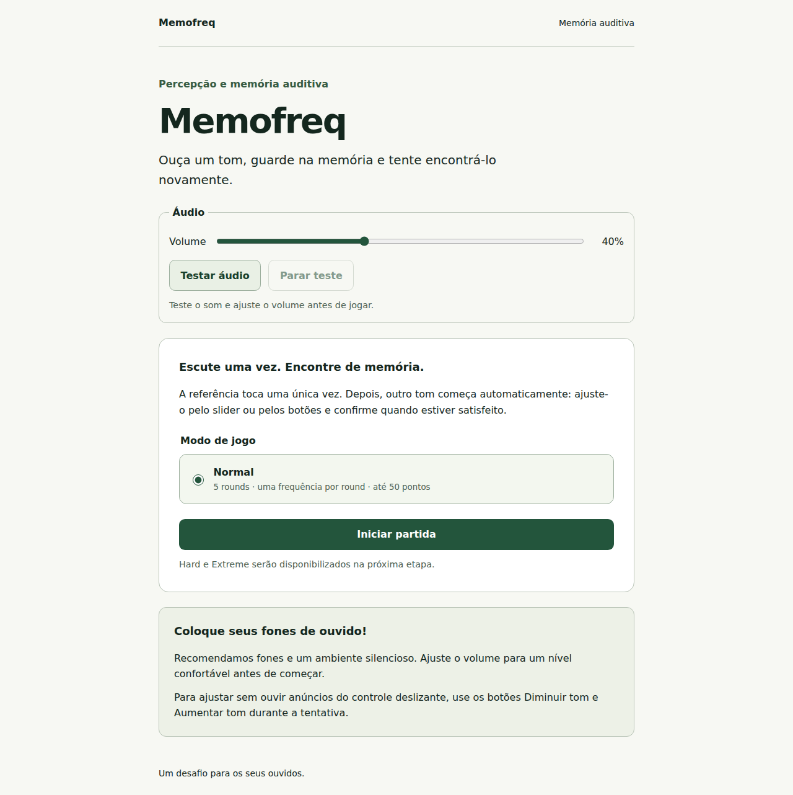
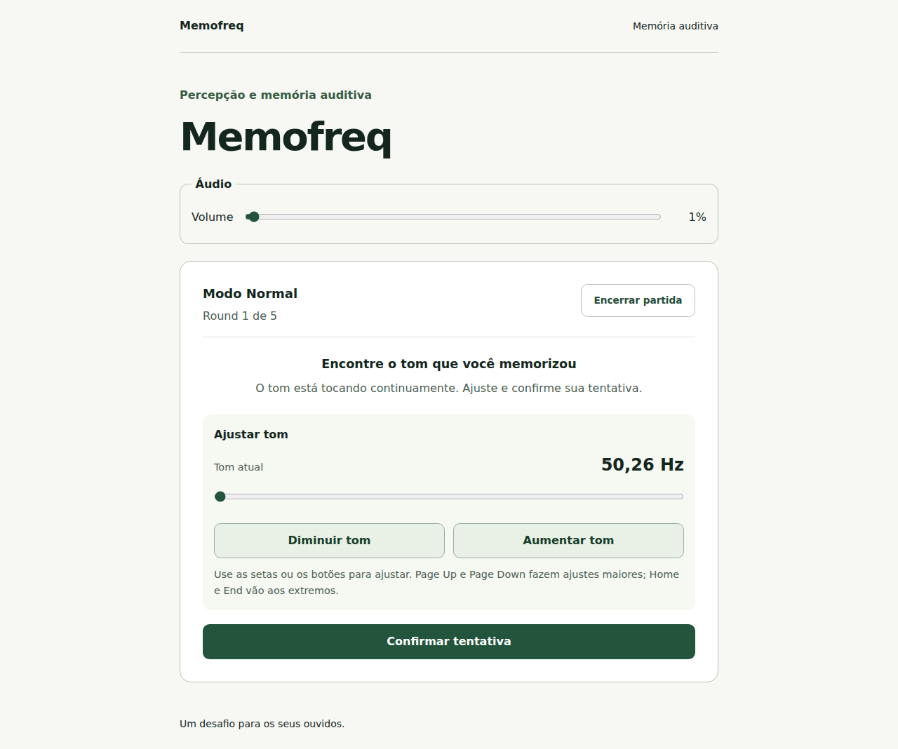
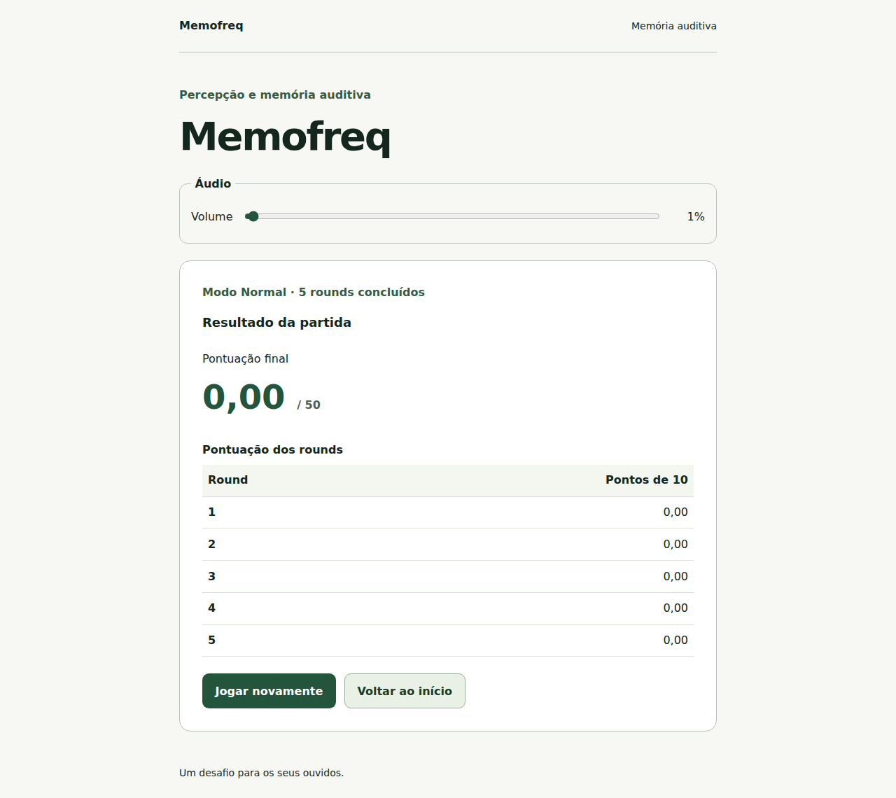
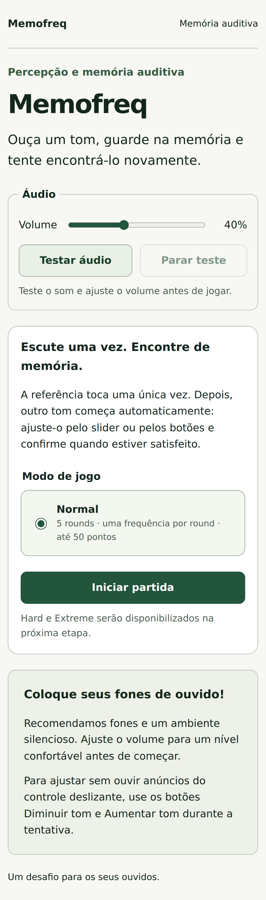
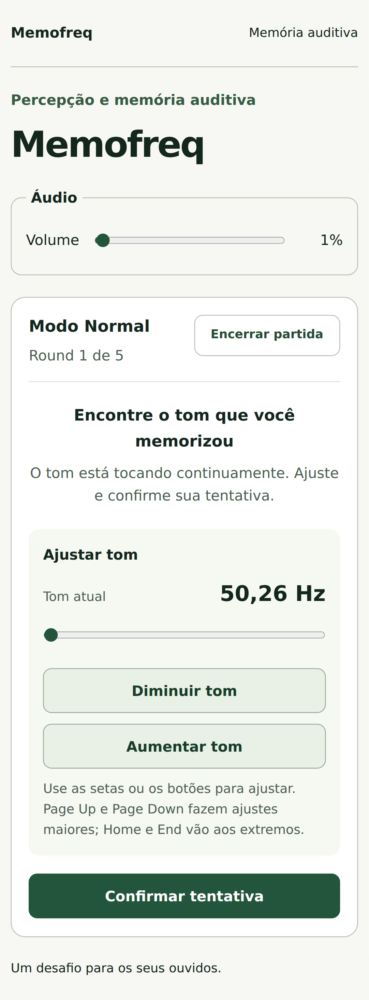
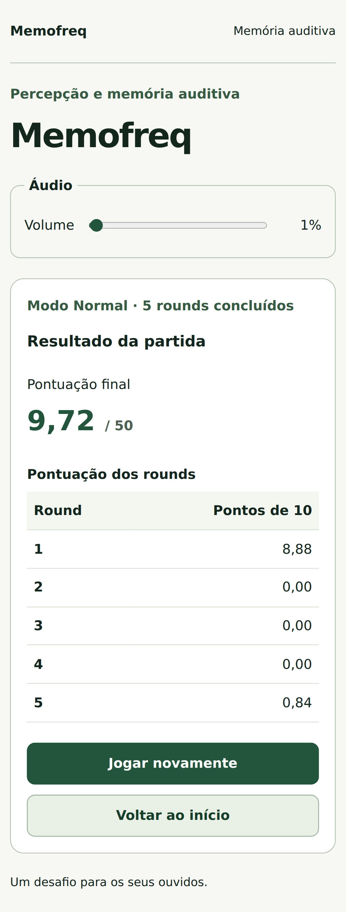

# Memofreq — Relatório consolidado com capturas da interface

Para as novidades posteriores, consulte o [relatório da Fase 5](phase-5-report.md), que registra Hard, Extreme e novas capturas.

Data: 26/10/2026. Abrange as Fases 1 a 4, até o commit `07b05c7`. A interface está funcional para jogar Normal e testar o áudio; o acabamento visual definitivo permanece para uma etapa posterior. A Fase 5 não foi iniciada.

## O que foi construído

| Fase                  | Entregas                                                                                                                           | Relatório detalhado                                    |
| --------------------- | ---------------------------------------------------------------------------------------------------------------------------------- | ------------------------------------------------------ |
| 1 — Fundação          | React, TypeScript estrito, Vite, estilos iniciais, ferramentas de qualidade, testes, CI, documentação e repositório privado        | [Arquivos e verificações da Fase 1](phase-1-report.md) |
| 2 — Domínio e estados | Configuração das modalidades, escala logarítmica, sorteios, pontuação em cents, modelos imutáveis e transições protegidas          | [Arquivos e verificações da Fase 2](phase-2-report.md) |
| 3 — Engine de áudio   | Web Audio nativa, tons senoidais, envelopes, volume, sequências, tom contínuo, cancelamento e limpeza de recursos                  | [Arquivos e verificações da Fase 3](phase-3-report.md) |
| 4 — Normal jogável    | Integração entre domínio, áudio e React; cinco rounds completos, controles por teclado, resultados textuais e interface responsiva | [Arquivos e verificações da Fase 4](phase-4-report.md) |

Os relatórios individuais registram a situação ao término de cada fase. Referências neles a fases seguintes ainda não autorizadas são históricas; o estado atual é a Fase 4 concluída.

### Comportamento disponível na interface

- Tela inicial com instruções, Normal selecionado, teste de áudio, parada do teste e volume.
- Cinco rounds com contagem de três segundos, referência de três segundos ouvida uma vez e tom contínuo iniciado automaticamente.
- Ajuste logarítmico de 50 a 700 Hz por slider, botões e teclado; confirmação definitiva da resposta.
- Frequência visual no Normal e apresentação de alvo, resposta, diferença e pontuação após o término suave do tom.
- Resultado final com total de até cinquenta pontos, tabela dos rounds, reinício e retorno ao início.
- Ocultação da aba na contagem exige retomada explícita; durante referência ou tentativa interrompe a partida; em resultados preserva os dados. Perda de foco isolada não invalida a partida.
- Precisão interna preservada e arredondamento somente na apresentação, em pt-BR com duas casas decimais.

O controle tem nome acessível estável, “Ajustar tom”, e texto de valor constante. A frequência visual e os resultados ficam fora de regiões vivas; os números podem ser consultados intencionalmente. Durante os tons, a aplicação mantém a região viva vazia. Botões de ajuste oferecem uma alternativa ao slider nativo. A fala real de leitores de tela ainda precisa ser avaliada, conforme as pendências abaixo.

## Capturas reais da interface

As seis imagens abaixo foram produzidas pelo Playwright na validação da Fase 4 e preservadas sem alteração. Mostram o build daquela versão, com Chromium desktop e emulação de Pixel 7. Frequências, volume e notas refletem entradas automatizadas de teste; não representam avaliação de desempenho de uma pessoa. Não são mockups do acabamento visual futuro.

### Desktop — Tela inicial



### Desktop — Tentativa



### Desktop — Resultado final



### Celular emulado — Tela inicial



### Celular emulado — Tentativa



### Celular emulado — Resultado final



## Arquivos e organização das mudanças

O inventário de criação das Fases 1, 2 e 3 está nos relatórios individuais vinculados acima. Na Fase 4, a engine e o domínio existentes foram conectados por uma camada de aplicação, mantendo suas responsabilidades separadas.

| Responsabilidade           | Arquivos criados na Fase 4                                                                                                            |
| -------------------------- | ------------------------------------------------------------------------------------------------------------------------------------- |
| Coordenação da partida     | `src/application/GameController.ts`, `src/application/useGameController.ts`, `src/app/createGameController.ts`                        |
| Componentes e apresentação | `src/ui/components/AudioControls.tsx`, `src/ui/components/ToneControl.tsx`, `src/ui/components/AttemptResult.tsx`, `src/ui/format.ts` |
| Testes e suporte           | `src/application/GameController.test.ts`, `src/test/controlledAudio.ts`, `e2e/normal.spec.ts`                                         |
| Relatório                  | `docs/phase-4-report.md`                                                                                                              |

Arquivos atualizados na Fase 4:

```text
AGENTS.md
README.md
docs/accessibility.md
docs/architecture.md
docs/audio-engine.md
docs/functional-spec.md
docs/implementation-plan.md
docs/manual-testing.md
src/app/App.tsx
src/app/App.test.tsx
src/application/README.md
src/domain/README.md
src/ui/styles/global.css
```

O [diff completo da Fase 4 no GitHub](https://github.com/MatDev435/Memofreq/compare/8c1997c...07b05c7) permite consultar cada alteração. Este relatório acrescenta apenas documentação e as seis imagens em `docs/images/phase-4/`. Nenhuma dependência foi adicionada nas Fases 2 a 4.

## Verificações executadas

| Etapa                                 | Evidência registrada na entrega                                                                                       |
| ------------------------------------- | --------------------------------------------------------------------------------------------------------------------- |
| Fundação                              | Dois testes de componentes e quatro E2E aprovados                                                                     |
| Domínio                               | 96 testes aprovados, incluindo 94 de domínio                                                                          |
| Engine                                | 141 testes unitários/componentes e oito E2E aprovados, com Web Audio nativa e renderização offline                    |
| Normal jogável                        | 157 testes unitários/componentes em oito arquivos e doze E2E aprovados                                                |
| Qualidade da Fase 4                   | `npm run check`: ESLint, Prettier, testes, TypeScript e build aprovados                                               |
| Acessibilidade automatizada da Fase 4 | Axe sem violações detectadas na inicial, tentativa e resultado final                                                  |
| Fluxo completo                        | Cinco rounds com durações reais nos dois perfis Chromium; teclado, foco, recursos de áudio e interrupções verificados |

As contagens são retratos da suíte em cada entrega; não devem ser somadas. A [execução remota da Fase 4](https://github.com/MatDev435/Memofreq/actions/runs/40369047377) concluiu com sucesso. Os testes de navegador não foram repetidos para a inclusão deste relatório e das imagens, pois não houve alteração da aplicação.

## Histórico de commits das Fases 1 a 4

| Fase | Commit    | Alteração                                      |
| ---- | --------- | ---------------------------------------------- |
| 1    | `c6d2aff` | Fundação React, TypeScript e Vite              |
| 1    | `c01bd86` | Regras aprovadas e plano de implementação      |
| 1    | `3b6155f` | Relatório de validação e entrega               |
| 2    | `47b629a` | Regras, geração de frequências e pontuação     |
| 2    | `0878d84` | Transições de estado protegidas                |
| 2    | `2d460cd` | Contratos de domínio e validação               |
| 3    | `3903021` | Engine Web Audio cancelável                    |
| 3    | `fe22945` | Testes de áudio nativo e renderização offline  |
| 3    | `8c1997c` | Contratos da engine e relatório de validação   |
| 4    | `a98fd85` | Coordenação entre áudio e ciclo da partida     |
| 4    | `7bd3a2c` | Interface Normal jogável e testes de navegador |
| 4    | `07b05c7` | Documentação e relatório da Fase 4             |

O repositório [MatDev435/Memofreq](https://github.com/MatDev435/Memofreq) é privado, com branch principal `main`. O [histórico no GitHub](https://github.com/MatDev435/Memofreq/commits/main/) inclui também as entregas documentais posteriores a esta versão da interface.

## Pendências e limites na entrega da Fase 4

Atualização posterior: o usuário relatou funcionamento da interface Normal com NVDA e assumiu os próximos testes manuais em 26/10/2026. Navegador, versões e casos específicos não foram informados; os itens abaixo retratam a situação original da entrega.

- Escuta humana com fones e avaliação perceptual do áudio ainda não executadas.
- Teste real com NVDA, VoiceOver e TalkBack pendente. O NVDA foi localizado no Windows, mas a ferramenta de controle falhou antes da interação; não há validação real de fala. Alguns leitores podem narrar valores nativos apesar das configurações ARIA.
- Firefox, Safari e aparelhos físicos ainda não avaliados. A emulação móvel e os eventos de visibilidade simulados não substituem esses testes.
- Hard e Extreme pertencem à Fase 5, ainda sem autorização; gráfico e revisão conjunta estão previstos na Fase 6. O acabamento visual definitivo permanece posterior.
- Não há backend, contas, persistência ou site publicado. Recarregar a página perde o progresso.

O [checklist manual](manual-testing.md) mantém os itens não executados em aberto. A interface atual já permite testar o áudio e o Normal pela prévia local, iniciada com `npm run dev`.
